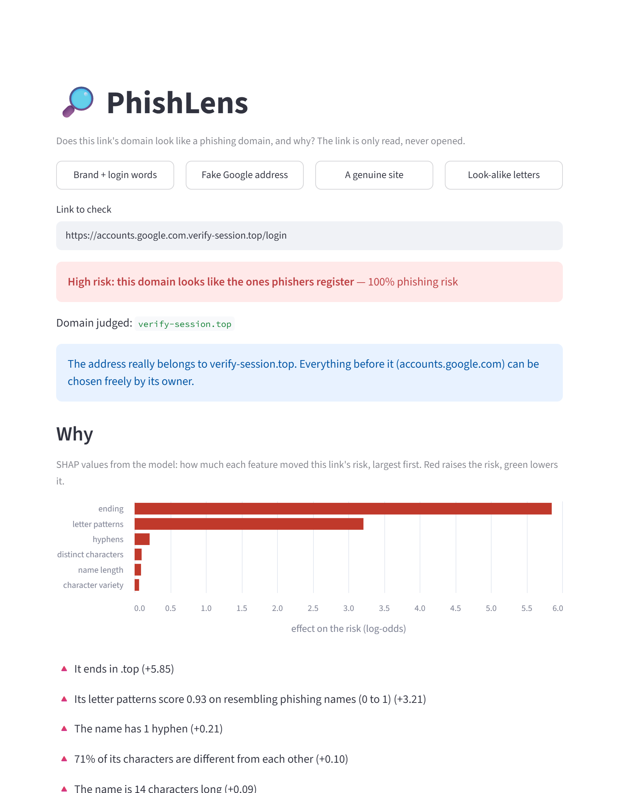
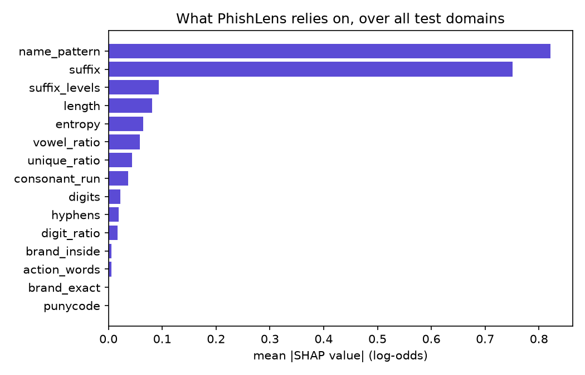
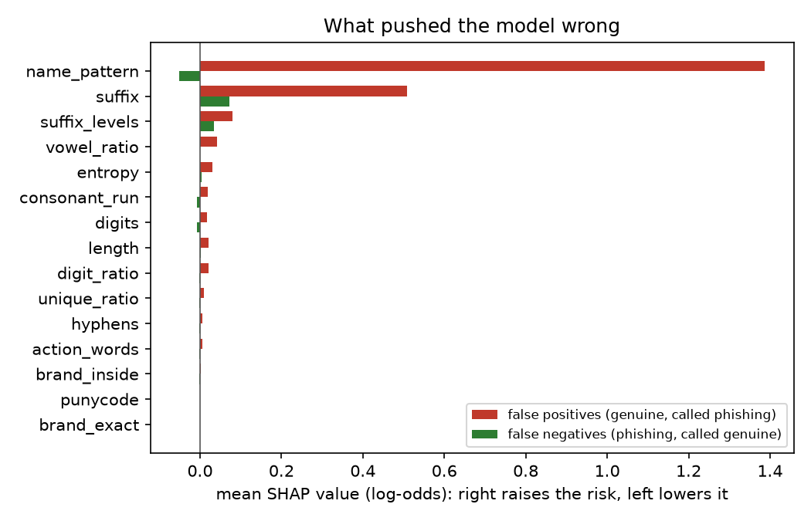

<h1 align="center">PhishLens</h1>

<p align="center"><strong>Paste a link and see whether its domain looks like one phishers register, and why, feature by feature, with SHAP.</strong></p>

<p align="center">
  <a href="https://github.com/Cl0ud-9/PhishLens/actions/workflows/ci.yml"></a>
  <a href="LICENSE"></a>
  
  
</p>

<p align="center">
  <a href="#quick-start">Quick start</a> &nbsp;·&nbsp;
  <a href="#why-only-the-domain">Why only the domain</a> &nbsp;·&nbsp;
  <a href="#how-it-works">How it works</a> &nbsp;·&nbsp;
  <a href="#results">Results</a> &nbsp;·&nbsp;
  <a href="#what-shap-shows">What SHAP shows</a> &nbsp;·&nbsp;
  <a href="#honest-limits">Honest limits</a>
</p>

<br>

<p align="center">
  
</p>

PhishLens reads a link, finds the domain it really belongs to, and scores how much that domain looks like the ones
phishers register. Every score comes with its reasons: the SHAP value of each feature, so you can see that a link was
flagged because it ends in `.top` and its name reads like `secure-verify-login`, not just that it was flagged.

The link is only read, never opened, so checking a dangerous link is safe.

## Quick start

You need Python 3.11, 3.12, 3.13 or 3.14. The trained model is in the repository.

```bash
git clone https://github.com/Cl0ud-9/PhishLens.git
cd PhishLens
python -m venv .venv
.venv\Scripts\activate          # macOS/Linux: source .venv/bin/activate
pip install -r requirements.txt
streamlit run app.py
```

Or from the command line, for one link or many:

```text
$ python predict.py https://paypal-secure-login-verify.com/signin
https://paypal-secure-login-verify.com/signin
  High risk: this domain looks like the ones phishers register (100%)
  domain judged: paypal-secure-login-verify.com
    raises risk 6.11  Its letter patterns score 0.99 on resembling phishing names (0 to 1)
    raises risk 0.50  It contains words that ask you to act: "login", "secure", "verify", "pay"
    raises risk 0.41  Character variety (entropy) is 3.87 bits
    raises risk 0.33  The name is 26 characters long
    raises risk 0.33  The name contains a brand ("paypal") without being that brand
    lowers risk 0.14  The name has 3 hyphens
```

`--json` prints the verdicts as JSON for use in other tools.

## Why only the domain

The model is trained on the [PhiUSIIL](https://archive.ics.uci.edu/dataset/967/phiusiil+phishing+url+dataset)
dataset of 235,795 URLs. Every one of its 134,850 legitimate URLs has the same shape, a bare home page:
`https://www.<domain>`, with no path and no query. The phishing URLs come in every shape.

That makes the whole URL a trap. A model given simple facts about a URL's shape (its length, whether it has `www`, a
path or `https`) scores **99.6% accuracy** on domains it never saw, and has learned nothing about phishing:

| Genuine link | That model's phishing probability |
|---|---|
| `https://github.com/Cl0ud-9` | 1.000 |
| `https://mail.google.com/mail/u/0/` | 1.000 |
| `https://en.wikipedia.org/wiki/Phishing` | 1.000 |
| `https://www.amazon.in/gp/cart` | 1.000 |

[scripts/url_shortcut.py](scripts/url_shortcut.py) reproduces this. So PhishLens looks only at the **registered
domain**, the part of the address its owner actually registered (`example.co.uk` in `https://login.example.co.uk/x`),
where the two classes can be compared fairly. Paths, `www` and other subdomains are never used.

## How it works

```
link ──> registered domain ──> name features ─┐
         (public-suffix list,   letter-pattern ┼──> LightGBM ──> risk score + SHAP value of each feature
          look-alike letters    score          │
          made visible)         ending (.top…) ┘
```

1. **Finding the real domain.** The host is read with the public-suffix list, so `accounts.google.com.verify-session.top`
   belongs to `verify-session.top` and `https://google.com@evil.xyz` goes to `evil.xyz`. Look-alike letters, such as a
   Cyrillic "а" in "pаypal", are turned into the `xn--` form a browser really uses, and flagged.
2. **Features of the name.** Length, digits, hyphens, vowels, runs of consonants, character variety (entropy), whether
   it borrows a brand without being that brand, words like "login" or "verify", and its ending (`.com`, `.top`, ...).
3. **Letter patterns.** A logistic regression on the name's character 2- to 5-grams scores how much it reads like
   phishing names. During training, each domain's score comes from a model that did not see that domain.
4. **LightGBM** combines them into a probability, and its built-in TreeSHAP gives each feature's exact SHAP value.
5. **Before the model:** official domains of commonly imitated brands (`google.com`, `onlinesbi.sbi`, ...) are
   recognised from a [short list](phishlens/official.py), and bare IP addresses are flagged. The results below do not
   use the list.

**Shared hosting.** Sites on platforms where anyone can publish (`*.web.app`, `*.vercel.app`, `*.workers.dev`, ...) make
up 26,790 of the dataset's URLs, and 99.6% of them are phishing, because the legitimate URLs are all big sites' own
domains. A model trained on them would condemn every site on those platforms. They are left out of training, and when
you check one, PhishLens judges the site's own name as if it ended in `.com` and says so.

## Results

Measured on 43,673 registered domains the model never saw: a quarter of the 174,689 domains left after cleaning,
split at random with the same share of phishing (24.5%) on both sides. Each domain appears once.

| Measure | Result |
|---|---|
| ROC AUC | **0.831** |
| ... the letter-pattern score alone | 0.771 |
| Average precision | 0.712 |
| At a 0.5 threshold: precision / recall | 0.814 / 0.442 |

How the score bands did:

| Band | Share of domains | Of them, phishing |
|---|---|---|
| High risk (70% and above) | 9.4% | **91.5%** |
| Uncertain (30% to 70%) | 14.1% | 42.9% |
| Low risk (below 30%) | 76.5% | 12.8% |

In words: a high-risk verdict is right nine times in ten, but the model finds fewer than half of all phishing
domains. Many phishing domains have ordinary-looking names, and from the name alone they cannot be told apart.

## What SHAP shows

<p align="center">
  
  
</p>

- **What the model relies on (left).** The letter-pattern score and the ending carry most of the weight; length,
  character variety and the share of vowels refine it.
- **Why it gets things wrong (right).** Genuine domains called phishing were pushed there mainly by their letter
  patterns and ending: unusual but real names, often on less common endings. Phishing domains called genuine show no
  strong push at all: their names simply look normal, which is the limit of judging by name.

`python train.py --figures docs/img` rebuilds the model, these numbers and both charts.

## Honest limits

<details>
<summary>What PhishLens can and cannot tell you</summary>

<br>

- **It judges the name, not the page.** A genuine-looking domain can still host a phishing page, and a hacked genuine
  site can serve one. Treat a low score as "no red flags in the name", not as proof of safety.
- **It finds fewer than half of all phishing domains**, as the results show. It is a second opinion, not a filter.
- **Names that swap letters for digits are suspect**, because phishers do it (`paypa1`, `g00gle`). Genuine names that do
  the same, like `cl0ud-9`, are rated high risk.
- **The genuine side of the data is popular sites.** Small, new or unusual genuine domains look less like them, so they
  score higher than they should.
- **Shared-hosting sites are judged by their name alone**, without any help from the training data.
- **The data is from 2024.** Phishers change their habits; the model does not learn after training.

</details>

## Retrain

```bash
pip install -r requirements-dev.txt
python train.py --figures docs/img
```

`train.py` downloads the dataset from UCI (57 MB) if it is not in `data/`, checks its SHA-256, and writes the model to
`models/`. The model is saved as plain files, LightGBM's text format, a NumPy array and JSON, so loading one never runs
code.

## Project structure

```text
app.py                     the Streamlit app
predict.py                 check links from the command line
train.py                   train, measure and explain the model
phishlens/
  domains.py               finding the registered domain, look-alike letters, shared hosting
  features.py              what is measured about a name, and how to say it in words
  pattern.py               the letter-pattern model
  model.py                 combining them with LightGBM, SHAP values, saving and loading
  check.py                 a link's verdict, score, reasons and notes
  official.py              official domains of commonly imitated brands
  data.py                  downloading PhiUSIIL and reducing it to one row per domain
models/                    the trained model and its metrics
scripts/url_shortcut.py    the whole-URL trap, reproduced
tests/                     pytest suite
```

## Development

```bash
pip install -r requirements-dev.txt
ruff check .
pytest
```

The tests cover reading hosts (including the `@` trick, IPv6 and look-alike letters), the features, the verdicts and
their notes, that the SHAP values add up to the model's score, saving and loading, cleaning the dataset, a full training
run on generated data, and the command line. They run on every push for Python 3.11 to 3.14. See
[CONTRIBUTING.md](CONTRIBUTING.md) before opening a pull request, and [SECURITY.md](SECURITY.md) to report a
vulnerability. [CHANGELOG.md](CHANGELOG.md) says what changed in each version.

## License

The project is **source-available**: Copyright 2026 Cloud/9, all rights reserved. You can read the source, run it and
its model for personal, educational and non-commercial research use, and fork it to contribute back. Redistributing it,
publishing modified copies, running it as a service for other people, selling it, or using it or its model to train
other models is not allowed without written permission. See [LICENSE](LICENSE) for the full terms.

The PhiUSIIL dataset is licensed under CC BY 4.0, and it and the libraries the project uses keep their own licenses,
listed in [NOTICE](NOTICE).

<br>

<p align="center">
  <sub>Made by <a href="https://github.com/Cl0ud-9">Cloud/9</a>.</sub>
</p>
